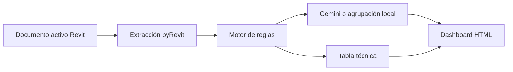

# Arquitectura y datos

## Flujo

## Organización

`BIMCheckAI.extension/BIMCheckAI.tab/Validacion.panel/Exportar.pushbutton/script.py` contiene extracción, reglas, solicitud HTTP, generación HTML y apertura del navegador en un solo archivo. Su código de nivel superior ejecuta la auditoría al cargarlo; no debe importarse fuera de Revit como biblioteca.

`BIMCheckAI.extension/BIMCheckAI.tab/Validacion.panel/Limpiar.pushbutton/script.py` contiene el restablecimiento gráfico mediante transacción.

## Extracción

El recolector excluye tipos y elementos dependientes de vistas. La lista blanca incluye muros, puertas, ventanas, suelos, cubiertas, techos, pilares arquitectónicos y estructurales, vigas, cimentación, escaleras, barandillas, paneles y montantes de muro cortina, rampas y modelos genéricos. Los filtros usan BuiltInCategory, pero las reglas posteriores comparan nombres de categoría localizados.

Cada ficha contiene `id` como cadena, `categoria` y `parametros` como diccionario de nombres a valores mostrados o cadenas. Se recorren parámetros de instancia; no hay extracción adicional sistemática de parámetros del tipo. Los nombres repetidos se sobrescriben en el diccionario. Valores no recuperables pueden quedar como null.

Cada hallazgo contiene `elemento_id`, `categoria`, `regla`, `severidad` y `mensaje`. La interpretación contiene `resumen_ejecutivo` y `hallazgos_agrupados`; cada grupo incluye `tema`, `cantidad`, `prioridad`, `explicacion` y `elementos_afectados`.

## Integración Gemini

Se utiliza la API REST `generateContent`, con clave en el encabezado `x-goog-api-key`. El código configura `gemini-2.5-flash` y después `gemini-2.5-flash-lite`, hasta tres intentos por modelo, timeout de 90 segundos y espera de dos segundos tras cada excepción. Estos nombres reflejan la configuración del código; la disponibilidad y las tarifas actuales no se verificaron.

Con cero hallazgos no se llama a la API. Sin clave o agotados los intentos, se agrupa por regla y se conserva la conversión de severidad a prioridad. La respuesta de IA se interpreta como JSON pero no se valida con un esquema ni se reconcilia con los hallazgos originales.

## Reporte y límites

La tabla técnica procede del motor. Los KPI de hallazgos, prioridades y afectados proceden de los grupos interpretados, por lo que pueden divergir si Gemini altera las cantidades o IDs. Los textos HTML se escapan y el JSON embebido protege la secuencia de cierre de script. Chart.js se descarga desde una CDN sin versión fijada. El manejo de su fallo permite conservar el detalle textual.

No se implementan almacenamiento histórico, registro detallado de errores de API, procesamiento asíncrono, corrección automática de elementos ni navegación del HTML hacia Revit.
